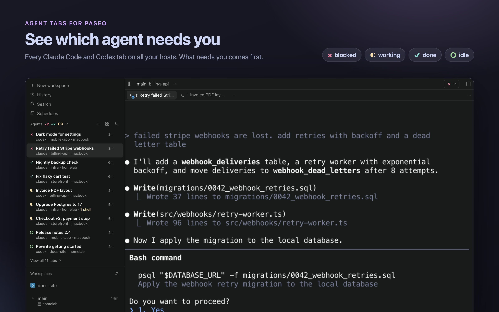
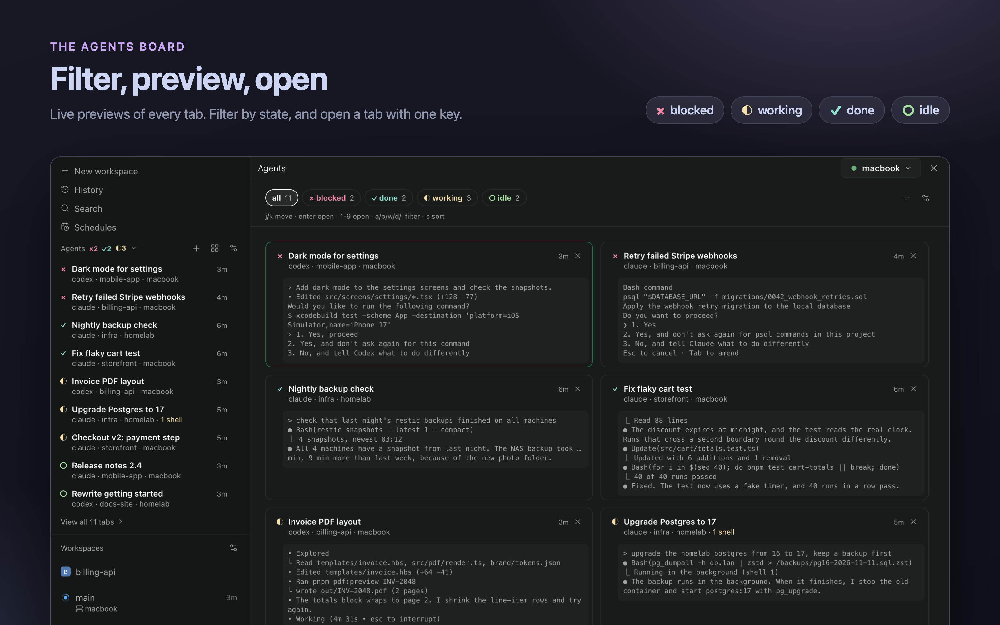
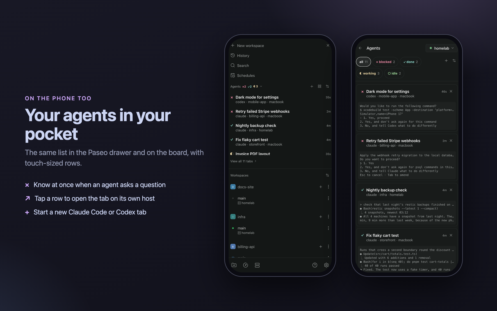

# Agent Tabs for Paseo

[](https://github.com/m190/paseo-agent-tabs/actions/workflows/ci.yml)



A [Paseo](https://paseo.sh) plugin that shows which Claude Code or Codex tab needs you, on every Paseo host, on desktop and on the phone.

Paseo's own lists show Paseo agents. Many people run Claude Code and Codex in plain terminal tabs instead. Agent Tabs lists those tabs, one row per tab, with a state symbol in the style of [herdr](https://github.com/herdrdev/herdr):

| Symbol | State |
| --- | --- |
| `×` | blocked: a question, a permission dialog, or Codex "Action Required" |
| `◐` | working, also while a background shell runs |
| `✓` | done, and you did not look at the tab yet |
| `○` | idle |
| `·` | unknown: a plain shell, or an agent without hooks |

It shows in the left sidebar, on an "Agents" board screen, in a right-side panel, and behind a header button in every workspace. You can open a tab, start a new one from a Paseo terminal profile, or close one. See [OVERVIEW.md](OVERVIEW.md) for every feature.





The screenshots use demo projects and scripted agent screens.

## Install

```sh
paseo plugin add git:m190/paseo-agent-tabs
```

The plugin needs no `npm install`: Paseo builds it, and React, React Native and the Paseo packages come from the host.

Plugins must be on in `~/.paseo/config.json`: `"pluginsEnabled": true` at the top level. Then run `paseo daemon reload`.

With several hosts, install the plugin on each host. Every host then shows the tabs of all hosts in one list.

### Codex

Codex 0.167 and later runs its sessions in a shared `codex app-server` process by default. Its hooks then do not reach Paseo, and the plugin falls back to the Codex title and screen. Start Codex with `codex --no-daemon` in your Paseo terminal profile to get exact states.

## Compatibility

Tested with Paseo 0.15.x on macOS, Linux (Raspberry Pi), the web app, the desktop app, and the Android app. The manifest accepts Paseo 0.15.0 and later.

The public plugin API does not give everything this plugin needs yet. So it uses some Paseo internals, and a new Paseo version can break it:

- The terminal title and the agent activity come from Paseo's internal daemon client (`server/host-daemon.ts`). Its types are copied into that file, because Paseo cannot resolve the client package when it builds a plugin from Git.
- On web and desktop, a tab opens through the app's own navigation function, which the plugin finds in the app bundle (`client/navigation.ts`). On native apps it uses a `paseo://` link.

## Development

```sh
npm ci
npm run typecheck
npm test
paseo plugin add ./            # install from this directory
paseo plugin reload agent-tabs # after a change
```

The status rules are in `server/status.ts`, as pure functions with tests in `test/status.test.ts`.

## License

[MIT](LICENSE)
